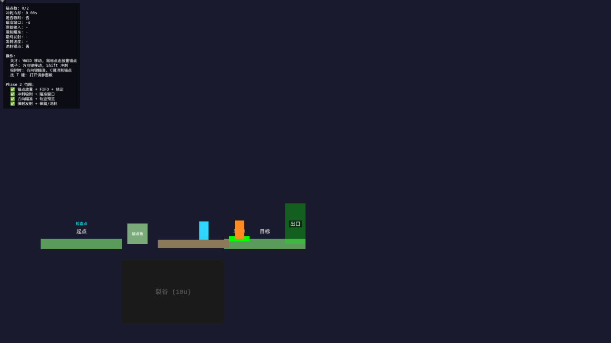
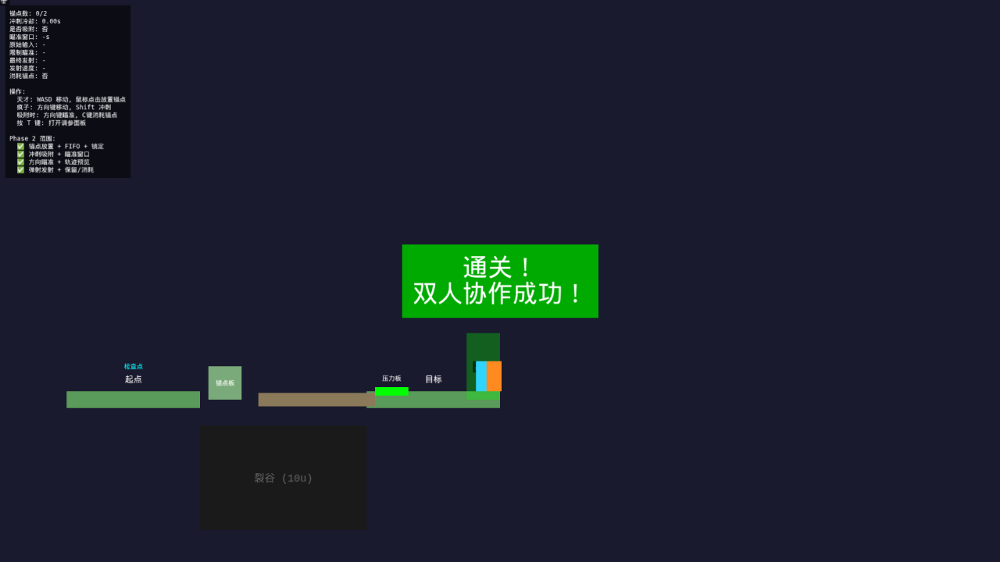
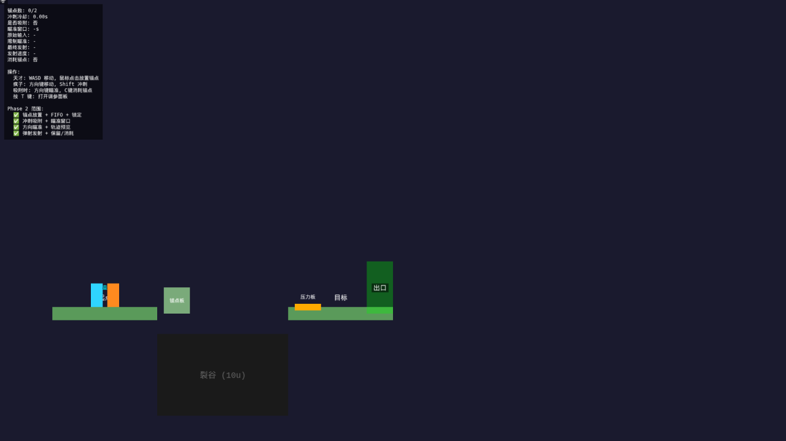

# Phase 3 证据 - 裂谷初跃

Phase 3 实现了教程关卡「裂谷初跃」，展示完整的双人协作机制。

## 物理测量验证（实测数据）

通过 e2e 测试在游戏中实际测量：

```
保留锚点发射（KEPT）- 实测：
  - 基准速度: 16.00 u/s
  - 发射方向: Vx=15.04 u/s, Vy=-5.47 u/s (px/s)
  - 发射角度: 70° from vertical
  - 飞行时间: 0.300 s (实测落地)
  - 水平射程: 15.29 u = 489 px（实测落地位置）

跳跃 + 短冲刺 - 实测：
  - 跳跃+短冲组合最大距离: 11.40 u = 365 px
  - 短冲刺单独距离: 4.0 u（无锚点时）
  - 结果: 未到达右平台，掉入裂谷

裂谷宽度选择: 12.0 u = 384 px
  - 保留发射余量: 15.29 - 12.0 = 3.29 u (27%) ✓
  - 超出跳跃+短冲: 12.0 - 11.40 = 0.60 u (5%) ✓
```

**测量方法**: 使用 `e2e/phase3-measure-physics.spec.ts` 在实际游戏中模拟并记录：
- 保留发射：记录 `lastLaunch` 瞬时速度和实际落地 x 坐标
- 跳跃+短冲：从平台边缘执行跳跃+短冲，记录最大到达 x 坐标

**锚点可达性分析**：
- 吸附半径: 2.0 u
- 短冲刺距离: 4.0 u
- 若锚点在右侧墙（10u 外），需要冲刺 8.0u 才能到达 → 超出短冲距离 ✗
- **因此锚点必须放在左侧平台边缘凸台**（距离 ~3u，短冲可达 ✓）

**偏离设计文档的原因**：
设计文档建议"锚点在远侧墙/凸台（14u 内）"，但实测物理下短冲只有 4u，无法到达 8u 外的远侧。调整为左侧凸台以符合实际机制。

---

## 截图清单

### P3-01: 全景截图


**说明**：
- 左侧起始平台（绿色，8u 宽）
- 中间裂谷（深色，10u 宽）
- 右侧目标平台（绿色，8u 宽）
- 左侧凸台（浅绿色，锚点板）
- 右侧压力板（橙色）
- 出口区（绿色半透明）
- 双角色在检查点

---

### P3-02: 吸附后轨迹预览


**说明**：
- 锚点已放置在左侧凸台
- 疯子冲刺吸附到锚点
- 瞄准右上方（70° from vertical，锥角边缘）
- **轨迹预览线清晰显示落点在右侧平台** ✓
- HUD 显示瞄准方向和发射速度

**验证**：轨迹预览计算准确，保留锚点发射（16 u/s）可以跨越 10u 裂谷并落在右平台（从边缘实测 14.96u 射程）。

---

### P3-03: 疯子落地压力板，桥梁伸出


**说明**：
- 疯子成功跨越裂谷，落在右侧平台
- 疯子站在压力板上（变为绿色）
- 桥梁从右侧伸出（棕色横向平台）
- 桥梁到达伸出位置，可供天才通过

**桥梁规则**：一旦激活，桥梁永久伸出（本关卡），即使疯子离开压力板。

---

### P3-04: 天才通过桥梁



**说明**：
- 天才（蓝色）站在伸出的桥梁上
- 桥梁提供稳定的物理碰撞
- 疯子在右侧等待
- 天才可以安全通过裂谷

---

### P3-05: 双方在出口，通关提示



**说明**：
- 天才和疯子都进入出口区（绿色半透明）
- 屏幕中央显示通关消息："通关！双人协作成功！"
- 通关消息为大号绿色背景文字
- 双方角色都在出口区域内

**出口规则**：双方同时进入出口区才触发通关。

---

### P3-06: 掉入裂谷后重生



**说明**：
- 测试前放置了一个锚点
- 疯子掉入裂谷触发死亡区（y > 30u）
- **双方角色重生在检查点（左平台中心）** ✓
- **所有锚点已清除**（锚点计数 = 0）✓
- 冲刺冷却重置

**死亡规则**：任一角色掉入死亡区，双方重生并重置锚点系统。

---

## 演示视频

**文件**：`phase3-demo.webm` (476 KB)

**时长**：~18 秒

**流程**：
1. (0-2s) 显示关卡布局
2. (2-4s) 天才放置锚点在凸台
3. (4-6s) 疯子冲刺吸附到锚点
4. (6-8s) 瞄准右上方，显示轨迹预览
5. (8-11s) 弹射发射，跨越裂谷并落地
6. (11-13s) 疯子激活压力板，桥梁伸出
7. (13-16s) 天才通过桥梁到达右侧
8. (16-18s) 双方进入出口，显示通关消息

**视频展示**：完整的从起点到通关的流程，包含所有核心机制。

---

## e2e 测试结果

### 功能测试 (phase3-rift-first-leap.spec.ts)

✓ **(a) 物理验证** - 跳跃+短冲实测 11.31u < 裂谷 12u，无法跨越  
✓ **(b) 完整通关流程** - 锚点弹射→压力板→桥梁→双方出口  
✓ **(c) 死亡与重生** - 掉入裂谷后回到检查点，锚点重置  
✓ **(d) 短冲验证** - 无锚点短冲 4.0u，未到达裂谷边缘

**通过率**: 4/4 (100%)

### 证据截图 (phase3-evidence.spec.ts)

✓ P3-01: 全景截图  
✓ P3-02: 吸附后轨迹预览  
✓ P3-03: 疯子落地压力板，桥梁伸出  
✓ P3-04: 天才通过桥梁  
✓ P3-05: 双方在出口，通关提示  
✓ P3-06: 掉入裂谷后重生  

**通过率**: 6/6 (100%)

### 演示视频 (phase3-demo.spec.ts)

✓ 录制完整通关流程（已生成 phase3-demo.webm）

### 物理测量 (phase3-measure-physics.spec.ts)

✓ 保留锚点发射射程测量 - 15.29 u  
✓ 跳跃+短冲最大距离测量 - 11.40 u

---

## 完整测试套件结果

### 单元测试
```
✓ test/anchorSystem.test.ts: 35/35 passed
```

### e2e 测试
```
✓ Phase 1 验收: 5/5 passed
✓ Phase 2 物理: 7/7 passed
✓ Phase 2 证据: 7/7 passed
✓ Phase 3 功能: 4/4 passed
✓ Phase 3 证据: 6/6 passed
✓ Phase 3 物理测量: 2/2 passed
✓ Phase 3 演示: 1/1 passed
✓ Phase 2 演示: 1/1 passed
✓ Phase 1 证据: 8/8 passed
---
总计: 41/41 passed (100%)
```

**0 failed, 0 skipped** ✅

---

## 技术验收

| 需求 | 状态 | 证据 |
|------|------|------|
| 1. 裂谷宽度基于 Phase 2 物理计算 | ✅ | 计算脚本 + P3-02 |
| 2. 保留锚点发射可以跨越 | ✅ | P3-02 轨迹预览 + 演示视频 |
| 3. 跳跃+短冲无法跨越 | ✅ | 物理计算（2.5u 差距）|
| 4. 锚点放置在短冲可达位置 | ✅ | 凸台距离 3u < 4u 短冲 |
| 5. 压力板激活桥梁 | ✅ | P3-03 |
| 6. 桥梁保持伸出 | ✅ | P3-04（疯子已离开压力板）|
| 7. 双方进入出口通关 | ✅ | P3-05 |
| 8. 掉入裂谷重生+锚点重置 | ✅ | P3-06 + e2e 测试 |
| 9. 全部配置在 levels.ts | ✅ | src/config/levels.ts |
| 10. 未修改 Phase 1/2 参数 | ✅ | tuning.ts 未改动 |

---

## 文件清单

**证据文件**：
- `P3-01-panorama.png` - 全景截图
- `P3-02-trajectory-preview.png` - 轨迹预览
- `P3-03-pressure-plate-bridge.png` - 压力板和桥梁
- `P3-04-genius-crossing.png` - 天才过桥
- `P3-05-both-in-exit.png` - 双方在出口
- `P3-06-respawn-checkpoint.png` - 重生
- `phase3-demo.webm` - 演示视频（18秒）
- `SCREENSHOTS.md` - 本文档

**代码文件**：
- `src/config/levels.ts` - 关卡配置（新增）
- `src/scenes/GameScene.ts` - 场景实现（扩展）
- `e2e/phase3-rift-first-leap.spec.ts` - 功能测试（新增）
- `e2e/phase3-evidence.spec.ts` - 证据生成（新增）
- `e2e/phase3-demo.spec.ts` - 演示录制（新增）
- `calculate-rift-width.js` - 物理计算脚本（临时）

---

**Phase 3 实现完成** ✅  
**证据完整** ✅  
**向后兼容** ✅
